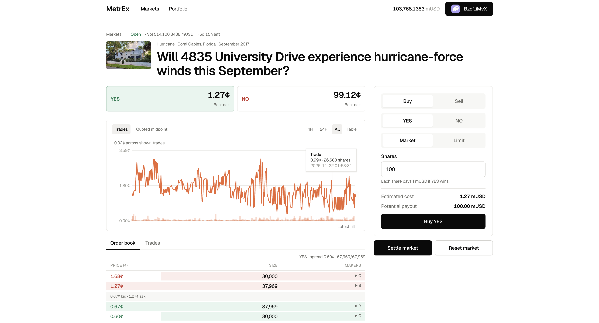
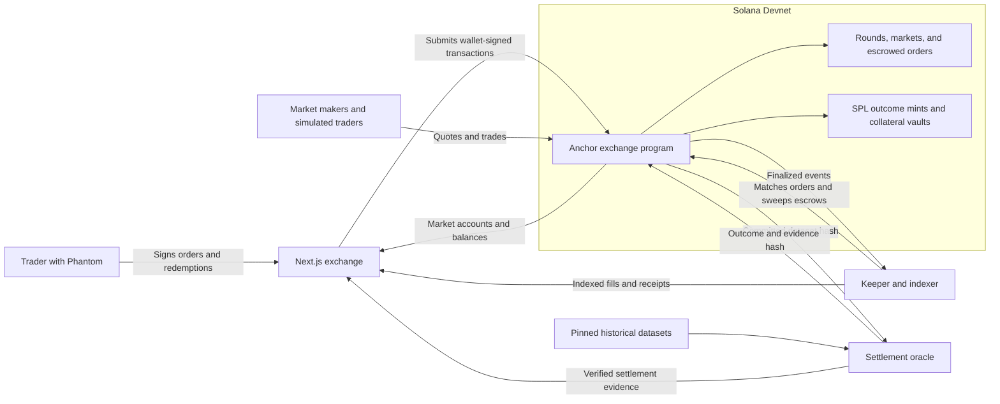

# MetrEx

[](https://www.youtube.com/watch?v=hXulKEAohr8)

[Watch the demo on YouTube](https://www.youtube.com/watch?v=hXulKEAohr8)

**An on-chain exchange for catastrophe risk, built at Hack Western 13 on Solana Devnet.**

MetrEx explores how people could buy and trade parametric protection for a specific property. Each market defines a measurable hazard trigger up front. The order book lets participants price the risk, and the payout follows the published rule once the market settles.

## What you can do

- **Explore four historical replays.** Follow the Palisades Fire, the September 2017 Atlantic hurricanes, the South Napa earthquake, and the May 2024 central Iowa tornadoes. Each market shows its coverage period, trigger, and settlement source.
- **Buy coverage or trade shares.** Connect Phantom and enter a coverage amount, or trade YES and NO shares directly. The fully escrowed limit order book supports partial fills.
- **List an eligible home.** Choose a property in a replay area and post an opening YES bid at your chosen price.
- **Verify and redeem.** Inspect finalized fills and settlement evidence, then redeem winning shares to your wallet.

## How a market works

1. **Define the trigger.** A round commits the SHA-256 hash of its historical dataset on-chain. Each market ties that round to a registered property and a rule, such as whether the Palisades Fire footprint came within 500 meters.
2. **Collateralize and trade.** The exchange uses mUSD as Devnet collateral. Depositing 1 mUSD into a market vault creates one YES share and one NO share as SPL tokens. Traders place escrowed orders on either side of the market.
3. **Close, settle, and redeem.** Closing a round stops trading for all its markets. The oracle verifies the dataset hash and evaluates each property's trigger. After settlement finalizes, the app makes the verified evidence available. Each winning share redeems for 1 mUSD from its market vault.

## Architecture



| Layer | Stack and responsibility |
| --- | --- |
| On-chain exchange | Rust, Anchor 0.32.3, Agave 4.1.2, and SPL Token. The program manages collateral, order execution, and redemption. [`programs/metrex-exchange`](programs/metrex-exchange/) |
| Web app | Next.js App Router, React, TypeScript, Tailwind CSS, Leaflet, and Phantom. The interface shows markets, order books, risk maps, and wallet positions. [`app`](app/) |
| Server and oracle | TypeScript and Turf.js. Server routes provide market data, while the oracle evaluates geospatial triggers and builds canonical evidence. [`packages/server`](packages/server/) · [`packages/geo`](packages/geo/) |
| Workers and shared logic | TypeScript workers quote markets, simulate participants, match orders, and index finalized events. Shared exchange code handles order planning, pricing, and ledger calculations. [`services`](services/) · [`packages/exchange`](packages/exchange/) |

## Run the Devnet demo

Use Node.js 24 and pnpm 10. Copy [the environment template](app/.env.example) to `app/.env.local` and follow the [operations guide](docs/operations.md#start-and-restart) to configure Devnet RPC, operator keys, and the pinned datasets.

```bash
pnpm install --frozen-lockfile
METREX_ORACLE_DATA_DIR="$HOME/.config/metrex/oracle-data" pnpm demo
```

Open [the local exchange](http://127.0.0.1:3015/) when the app reports that it is ready. The launcher starts the exchange, market makers, keeper, and indexer. The operations guide also covers enabling simulated traders.

## Verify and explore

```bash
pnpm test:ts
pnpm lint:ts
anchor test
```

[Exchange protocol](docs/spec-v2.md) · [Hazard and payout rules](docs/spec-multiperil.md) · [Historical datasets](data/DATASET-hazards.md) · [Simulation design](docs/spec-simulation.md) · [Devnet verification](docs/multiperil-verification.md) · [Legacy claim recovery](docs/operations.md#legacy-recovery)
